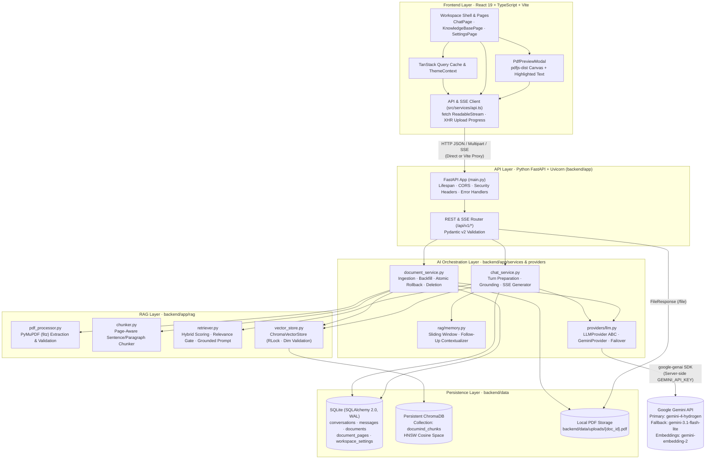
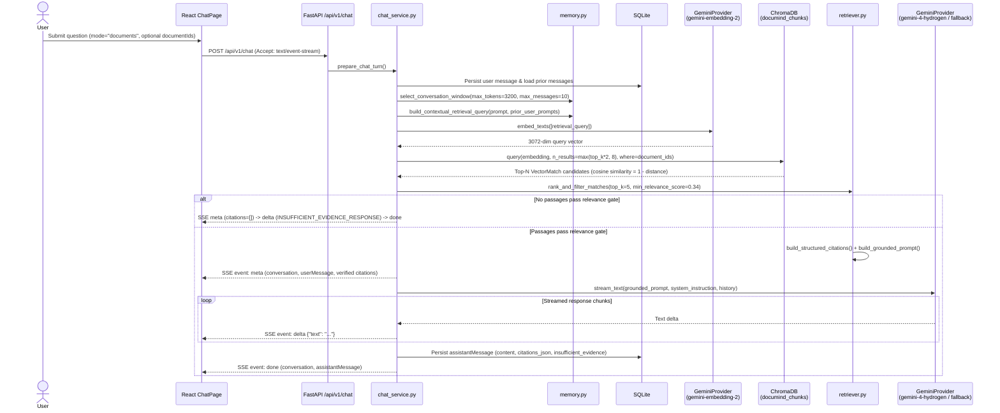
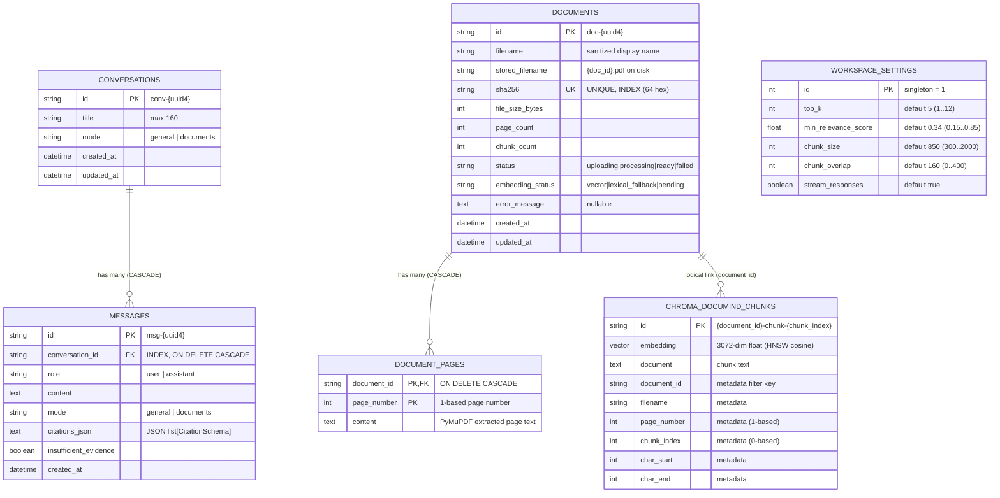

# DocuMind AI

**Your Knowledge. Intelligent Answers.**

[](https://www.python.org/)
[](https://fastapi.tiangolo.com/)
[](https://react.dev/)
[](https://www.typescriptlang.org/)
[](https://www.trychroma.com/)
[](https://www.sqlalchemy.org/)
[](https://ai.google.dev/)

DocuMind AI is a full-stack, retrieval-augmented conversational AI application that combines **general-purpose multi-turn LLM chat** with **evidence-grounded question answering over PDF documents**. Built with a **Python FastAPI** backend, **PyMuPDF**, **persistent ChromaDB**, **SQLAlchemy/SQLite**, and a **React + TypeScript** frontend, it lets users upload multi-page PDFs, query them with semantic and lexical retrieval, verify claims against page-level citations, and inspect the exact cited PDF page inside an interactive preview modal.

Unlike a minimal LLM prompt wrapper, DocuMind AI implements an end-to-end Retrieval-Augmented Generation (RAG) architecture with explicit engineering controls: binary PDF validation and SHA-256 deduplication, page-boundary-preserving overlapping chunking, dimensional consistency checks on persistent vector storage, hybrid dense-plus-lexical passage scoring with a relevance refusal gate, untrusted-data prompt encapsulation, server-isolated API credentials, pre-stream provider failover, token-budgeted conversational memory, and Server-Sent Events (SSE) token streaming.

> **Scope note:** DocuMind AI is designed and verified as a single-workspace local/containerized engineering system rather than a multi-tenant cloud SaaS deployment. Implemented safeguards and remaining production gaps are documented explicitly in [Security and Reliability](#17-security-and-reliability) and [Known Limitations](#18-known-limitations).

---

## Table of Contents

1. [Technical Highlights](#1-technical-highlights)
2. [System Architecture](#2-system-architecture)
3. [Retrieval-Augmented Generation Pipeline](#3-retrieval-augmented-generation-pipeline)
4. [Mathematical Foundations](#4-mathematical-foundations)
5. [Grounding and Hallucination Mitigation](#5-grounding-and-hallucination-mitigation)
6. [LLM Integration and Provider Architecture](#6-llm-integration-and-provider-architecture)
7. [Conversational Memory and Context Management](#7-conversational-memory-and-context-management)
8. [Streaming Architecture: Server-Sent Events (SSE)](#8-streaming-architecture-server-sent-events-sse)
9. [Database and Data Modeling](#9-database-and-data-modeling)
10. [Backend API Reference](#10-backend-api-reference)
11. [Frontend Architecture and UI/UX](#11-frontend-architecture-and-uiux)
12. [Project Structure](#12-project-structure)
13. [Installation and Local Development](#13-installation-and-local-development)
14. [Configuration Reference](#14-configuration-reference)
15. [Testing and Verification](#15-testing-and-verification)
16. [Engineering Tradeoffs](#16-engineering-tradeoffs)
17. [Security and Reliability](#17-security-and-reliability)
18. [Known Limitations](#18-known-limitations)
19. [Future Improvements](#19-future-improvements)
20. [Demo and Interview Walkthrough](#20-demo-and-interview-walkthrough)

---

## 1. Technical Highlights

| Capability | Implementation Summary | Source Module(s) |
| --- | --- | --- |
| **Dual-Mode Conversational RAG** | Supports open `general` LLM chat and evidence-constrained `documents` mode with optional per-request document scoping (`documentIds`). | `backend/app/services/chat_service.py` |
| **Hardened PDF Ingestion** | Validates `.pdf` extension, MIME type, `%PDF-` magic header, 25 MB limit, SHA-256 uniqueness, encryption, corruption, and scanned/image-only PDFs (`< 15` chars). | `backend/app/rag/pdf_processor.py`, `backend/app/services/document_service.py` |
| **Page-Aware Overlapping Chunking** | Splits each PDF page independently (`chunk_size=850`, `chunk_overlap=160` default) preferring paragraph, sentence, and whitespace boundaries without crossing page breaks. | `backend/app/rag/chunker.py` |
| **Real Vector Embeddings** | Generates dense embeddings in batches of 20 via `google-genai` (`gemini-embedding-2`, 3072 dimensions observed live) with per-item `types.Content` wrapping. | `backend/app/providers/llm.py`, `backend/app/services/document_service.py` |
| **Persistent Vector Indexing** | Stores chunks, embeddings, and page metadata in a persistent local ChromaDB HNSW cosine collection (`documind_chunks`) with lock-protected access and dimension validation. | `backend/app/rag/vector_store.py` |
| **Hybrid Semantic + Lexical Retrieval** | Queries ChromaDB in cosine space (`0.72` weight), anchors with weighted lexical overlap (`0.28` weight), applies a zero-lexical false-positive guard, and enforces `minRelevanceScore`. | `backend/app/rag/retriever.py` |
| **Evidence-Grounded Generation** | Encapsulates retrieved passages in numbered `<evidence>` XML tags marked as untrusted data; declines honestly when no passage meets the relevance gate. | `backend/app/rag/retriever.py`, `backend/app/services/chat_service.py` |
| **Source Attribution & PDF Navigation** | Builds deduplicated `(documentId, pageNumber)` citations directly from ChromaDB metadata; clicking any citation opens the exact page in a `pdfjs-dist` canvas & highlighted-text modal. | `backend/app/rag/retriever.py`, `src/components/PdfPreviewModal.tsx` |
| **Conversational Memory & Follow-Up Resolution** | Retains recent turns within a 3,200-token / 10-message budget and appends prior user context to short or anaphoric follow-up retrieval queries. | `backend/app/rag/memory.py` |
| **Token Streaming via SSE** | Streams `meta`, `delta`, `done`, and `error` events over `text/event-stream` with client-side `AbortController` cancellation and optimistic UI state. | `backend/app/api/routes.py`, `src/services/api.ts` |
| **Provider Abstraction & Failover** | Abstract `LLMProvider` base class with `GeminiProvider`, typed exception classification, retry before first token, and pre-stream fallback (`GEMINI_FALLBACK_MODEL`). | `backend/app/providers/llm.py`, `backend/app/core/errors.py` |
| **Relational + Vector Persistence** | SQLAlchemy 2.0 on SQLite (`WAL` mode + `PRAGMA foreign_keys=ON`) stores conversations, messages, documents, extracted pages, and retrieval settings alongside ChromaDB and disk PDFs. | `backend/app/models/entities.py`, `backend/app/db/session.py` |
| **Responsive React Workspace** | React 19 + TypeScript + TanStack Query + Tailwind CSS v4 with Midnight Dark and Daylight Alabaster themes, mobile navigation drawer, and safe Markdown rendering. | `src/App.tsx`, `src/layouts/WorkspaceLayout.tsx`, `src/pages/` |

---

## 2. System Architecture

DocuMind AI uses a **strict Python FastAPI backend** (there is no Express.js or Node.js API layer). In local development, Vite serves the React SPA on port `3000` and proxies `/api`, `/docs`, `/redoc`, and `/openapi.json` to FastAPI (default port `8000`, or an automatically probed free port). In production or static-serving mode (`npm run start` or `SERVE_STATIC_FROM_FASTAPI=true`), FastAPI directly serves both the compiled `dist/` SPA assets and the `/api/v1/*` API on a single port.



### Layer Responsibilities and Data Boundaries

1. **Frontend Layer (`src/`):** Manages interactive chat rendering, optimistic user messages, incremental SSE token accumulation, PDF upload progress (`XMLHttpRequest`), document scope filtering, and client-side PDF rendering (`pdfjs-dist`). It never accesses AI credentials or vector databases directly.
2. **API Layer (`backend/app/main.py`, `backend/app/api/routes.py`, `backend/app/schemas/api_schemas.py`):** Enforces strict Pydantic v2 input/output contracts, attaches security headers (`X-Content-Type-Options: nosniff`, `Referrer-Policy: no-referrer`), normalizes all domain/provider/validation exceptions into `{ "error": { "code", "message" } }`, and manages single-instance startup initialization via FastAPI's `lifespan` context manager.
3. **AI Orchestration Layer (`backend/app/services/`, `backend/app/providers/`):** Coordinates multi-turn chat persistence, mode routing (`general` vs. `documents`), lazy vector backfilling for pending seeded documents, grounded prompt assembly, and provider lifecycle management (retries, timeouts, pre-stream failover).
4. **RAG Layer (`backend/app/rag/`):** Pure, independently unit-testable modules for PDF parsing, text normalization, chunking, vector storage, hybrid passage ranking, citation extraction, and conversational memory windowing.
5. **Persistence Layer (`backend/data/`):** Separates relational state (SQLite) from dense vector indexing (ChromaDB) and binary PDF artifacts (`uploads/`), coordinated by `document_service.py` to keep metadata, files, and vectors synchronized across inserts and deletes.

---

## 3. Retrieval-Augmented Generation Pipeline

DocuMind AI splits RAG into a deterministic **Offline Ingestion Pipeline** (run at PDF upload or startup backfill) and a latency-sensitive **Online Query Pipeline** (run on every `mode: "documents"` chat turn).

### A. Offline / Ingestion Pipeline

```mermaid
flowchart LR
    UP["POST /api/v1/documents/upload<br/>(Multipart PDF)"] --> VAL["1. File Validation<br/>Ext · MIME · ≤25 MB · %PDF- · SHA-256"]
    VAL --> EXT["2. PyMuPDF Extraction<br/>Page-by-page text · Reject encrypted,<br/>corrupted, empty, or scanned (<15 chars)"]
    EXT --> CHK["3. Page-Aware Chunking<br/>chunk_size=850 · overlap=160<br/>Paragraph/sentence boundary split"]
    CHK --> EMB["4. Batch Embedding<br/>gemini-embedding-2 (batch_size=20)<br/>types.Content per chunk"]
    EMB --> IDX["5. ChromaDB Upsert<br/>Dim check · HNSW cosine<br/>ID: {doc_id}-chunk-{idx}"]
    IDX --> META["6. Atomic Persistence<br/>Disk PDF + SQLite documents<br/>& document_pages"]
    META -. "On failure: rollback SQLite,<br/>delete Chroma vectors & unlink PDF" .-> RB["Cleanup Rollback"]
```



#### 1. PDF Validation (`document_service.py`, `pdf_processor.py`)
- **Extension & MIME checks:** Requires a `.pdf` filename suffix and a PDF-compatible MIME type (`application/pdf`, `application/x-pdf`, `application/octet-stream`, or empty); rejects others with `415 UNSUPPORTED_FILE_TYPE`.
- **Magic header verification:** Scans the first `1024` bytes for the `%PDF-` signature (`is_pdf_magic_header`); rejects spoofed files with `422 INVALID_PDF`.
- **File size enforcement:** Rejects empty payloads (`400 EMPTY_FILE`) and files exceeding `MAX_FILE_SIZE_MB` (default `25 MB`, `413 FILE_TOO_LARGE`).
- **SHA-256 deduplication:** Computes `hashlib.sha256(pdf_bytes).hexdigest()` and queries the `UNIQUE` `documents.sha256` column. Duplicate uploads are rejected before extraction or embedding with `409 DUPLICATE_DOCUMENT`.
- **Corruption, encryption, and scanned-PDF handling:**
  - Unreadable binaries raise `422 CORRUPTED_PDF`.
  - Password-protected PDFs (`doc.needs_pass`) raise `422 ENCRYPTED_PDF`.
  - Zero-page PDFs raise `422 EMPTY_PDF`.
  - PDFs with fewer than `15` total normalized characters across all pages are classified as image-only/scanned and rejected with `422 SCANNED_PDF` rather than silently indexing empty text.

#### 2. Text Extraction (`pdf_processor.py`)
- Uses **PyMuPDF (`fitz`)** (`fitz.open(stream=pdf_bytes, filetype="pdf")`) for fast, in-memory extraction directly from uploaded bytes without requiring temporary disk writes prior to validation.
- Iterates strictly by page index (`0 .. page_count - 1`), calling `page.get_text("text")` and `normalize_extracted_text()` (strips null bytes, normalizes `\r\n`/`\r`, collapses horizontal whitespace and excess blank lines, trims line margins).
- Emits `PageText(page_number=idx + 1, text=cleaned)`, preserving exact **1-based page numbers** that are persisted verbatim into SQLite's `document_pages` table for fast citation lookup and highlighted-text inspection.

#### 3. Chunking Strategy (`chunker.py`)
- **Algorithm:** Page-scoped sliding-window character chunker (`chunk_pages`) with boundary-aware splitting.
- **Configured defaults (editable via Settings):** `chunk_size = 850` characters (clamped to `300..2000` in API, `>= 200` internally), `chunk_overlap = 160` characters (`0..400` in API, clamped to `<= chunk_size // 2` internally), `min_chunk_length = 40` characters.
- **Boundary-aware splitting:** If a page exceeds `chunk_size`, the splitter searches backward inside the trailing 45% window (`start + int(size * 0.55)` to `start + size`) in priority order:
  1. Paragraph break (`\n\n`)
  2. Sentence break (`. `, `? `, `! `, or `.\n`)
  3. Whitespace break (`" "`)
  4. Hard character boundary fallback if none exist
- **Why page-aware chunking protects citation precision:** Each page is chunked independently; a chunk never spans across pages `N` and `N+1`. Every vector in ChromaDB therefore maps unambiguously to a single `page_number`, eliminating ambiguous multi-page citations when users click a source card.
- **Overlap and size tradeoffs:** A 160-character overlap (~19% of 850 chars) preserves entity references and qualifiers across adjacent chunks on dense pages. Smaller chunks improve retrieval localization and citation granularity at the cost of splitting multi-sentence context; larger chunks retain broader reasoning context at the cost of diluted embedding vectors and higher LLM prompt token usage.

#### 4. Embedding Generation (`providers/llm.py`, `document_service.py`)
- **Configured model:** `gemini-embedding-2` (overridable via `GEMINI_EMBEDDING_MODEL`).
- **Observed dimensionality:** `3072` floats per chunk vector (verified live via `/api/v1/health` and ChromaDB collection inspection).
- **Batching and SDK correctness:** Chunks are embedded in batches of `20` (`_embed_chunks_in_batches`). Inside `GeminiProvider.embed_texts()`, each chunk string is explicitly wrapped as `types.Content(parts=[types.Part.from_text(text=item)])`. In the `google-genai` Python SDK, passing a bare `list[str]` to `gemini-embedding-2` collapses all strings into a single multi-part multimodal input returning 1 vector; wrapping each string in `types.Content` guarantees a 1:1 list of `N` independent dense vectors.
- **Normalization & dimensionality safety:** Vectors are stored as returned by the Gemini API without manual client-side renormalization; ChromaDB's cosine HNSW metric normalizes inner products by vector norms during similarity computation. Before every upsert or query, `ChromaVectorStore._validate_dimension()` verifies that incoming vector dimensionality matches the existing collection's dimension; switching `GEMINI_EMBEDDING_MODEL` to a model with different dimensions raises an explicit `409 EMBEDDING_DIMENSION_MISMATCH` error instead of corrupting the index.

#### 5. Vector Storage (`vector_store.py`)
- **Why ChromaDB:** Provides an embedded, disk-backed HNSW vector index (`chromadb.PersistentClient`) with native metadata filtering and zero external database infrastructure for local deployment.
- **Collection configuration:** Persistent directory `backend/data/chroma_db`, telemetry disabled (`anonymized_telemetry=False`), collection name `documind_chunks`, HNSW metric `{"hnsw:space": "cosine"}`.
- **Deterministic identifiers:** Vector IDs follow `{document_id}-chunk-{chunk_index}` (for example, `doc-meridian-annual-2026-chunk-0`), making re-indexing idempotent via `collection.upsert()`.
- **Stored metadata per vector:** `document_id`, `filename`, `page_number`, `chunk_index`, `char_start`, `char_end`.
- **Metadata scoping & cleanup:** Supports single-document (`{"document_id": id}`) and multi-document (`{"document_id": {"$in": ids}}`) `where` filters. Deleting a document calls `collection.delete(where={"document_id": document_id})` alongside disk file removal and SQLite row deletion, resetting the cached embedding dimension when the collection becomes empty.

---

### B. Online / Query Pipeline



#### Step-by-Step Query Mechanics
1. **Backfill check:** `ensure_documents_indexed_in_chroma()` verifies that all requested `status == "ready"` documents have live vectors in ChromaDB (automatically embedding seeded documents on first query if the server originally booted without `GEMINI_API_KEY`). If zero ready documents exist, it returns `NO_DOCUMENTS_INDEXED_RESPONSE` immediately.
2. **Follow-up query contextualization (`memory.py`):** If the conversation has prior user turns and the current prompt is either shorter than `26` characters or matches `FOLLOW_UP_PATTERN` (pronouns and discourse markers such as `it`, `they`, `that`, `above`, `more`, `elaborate`, `compare`, `what about`), `build_contextual_retrieval_query()` appends `(context: <previous_user_message[:180]>)` to the retrieval query so the embedding captures the implied subject.
3. **Document scope filtering:** When the user selects specific PDFs in the Chat document picker (or clicks *Chat with document* from Knowledge Base), `req.documentIds` restricts both the SQLite readiness check and ChromaDB's `where` metadata filter.
4. **Candidate over-fetching:** ChromaDB is queried for `n_results = max(ws_settings.top_k * 2, 8)` (capped at total collection count) to give the post-retrieval scorer a wider candidate pool.
5. **Hybrid dense + lexical scoring & relevance gate (`retriever.py`):**
   - Each candidate's ChromaDB cosine distance $d$ is converted to bounded cosine similarity $s_{\text{vec}} = \mathrm{clamp}(1 - d, 0, 1)$.
   - `compute_lexical_score()` tokenizes query and chunk text (removing common English and document-query stop words), assigns term weights (`1.6` for numeric tokens, `1.3` for tokens $\ge 6$ chars, `1.0` otherwise), awards `0.72×` partial credit for prefix stems on words $\ge 5$ chars, and adds a `+0.14` bigram match bonus (up to 2 bigrams).
   - Scores are fused as:
     $$\text{combined\_score} = 0.72 \cdot s_{\text{vec}} + 0.28 \cdot s_{\text{lex}}$$
   - **Zero-lexical guard:** Candidates with $s_{\text{lex}} = 0$ and $s_{\text{vec}} < \max(0.56, \text{min\_relevance\_score} + 0.22)$ are discarded to suppress off-topic dense-vector false positives.
   - **Relevance threshold:** Only passages with $\text{combined\_score} \ge \text{min\_relevance\_score}$ (default `0.34`, configurable `0.15..0.85`) survive; surviving passages are sorted descending and truncated to `top_k` (default `5`, configurable `1..12`).
6. **Evidence assembly & citation generation:**
   - Surviving passages are deduplicated by `(document_id, page_number)` into `CitationSchema` records containing query-centered excerpts (`<= 260` chars) extracted directly from chunk content.
   - `build_grounded_prompt()` wraps each ranked passage in an `<evidence index="k" filename="..." page="..." relevance="...">` block and sends it to the LLM alongside strict grounding rules and the conversation history window.
7. **Post-generation refusal reconciliation:** After streaming completes, `chat_service.py` checks whether the model emitted an insufficiency disclaimer without any inline `[filename, Page N]` citation; if so, `insufficient_evidence` is marked `True` and `citations` are cleared to `[]` before persisting to SQLite.

---

## 4. Mathematical Foundations

DocuMind AI represents document chunks and user queries as dense vectors in $\mathbb{R}^D$ (where $D = 3072$ for `gemini-embedding-2`). Semantic proximity is evaluated in ChromaDB's HNSW index using **cosine similarity**.

### Cosine Similarity

For a query embedding $\mathbf{A} \in \mathbb{R}^D$ and a document chunk embedding $\mathbf{B} \in \mathbb{R}^D$:

$$\mathrm{similarity}(\mathbf{A}, \mathbf{B}) = \frac{\mathbf{A} \cdot \mathbf{B}}{\|\mathbf{A}\| \, \|\mathbf{B}\|} = \frac{\sum_{i=1}^{D} A_i B_i}{\sqrt{\sum_{i=1}^{D} A_i^2} \, \sqrt{\sum_{i=1}^{D} B_i^2}}$$

- **Vector representation ($\mathbf{A}, \mathbf{B}$):** Learned continuous coordinates mapping semantically related phrases (e.g., *"disaster recovery failover target"* and *"Recovery Time Objective (RTO) of 45 seconds"*) to small angular separations even when exact vocabulary differs.
- **Dot product ($\mathbf{A} \cdot \mathbf{B}$):** Measures directional alignment scaled by vector lengths.
- **Euclidean magnitude ($\|\mathbf{A}\|, \|\mathbf{B}\|$):** Dividing by the $L_2$ norms removes magnitude sensitivity so passage length or embedding norm variance does not distort similarity ranking.
- **Range:** $\mathrm{similarity}(\mathbf{A}, \mathbf{B}) \in [-1, 1]$, where $1$ denotes identical direction, $0$ denotes orthogonality, and $-1$ denotes opposite direction.

### Cosine Distance in ChromaDB and Score Transformation

ChromaDB's `hnsw:space: "cosine"` index returns **cosine distance**:

$$d_{\cos}(\mathbf{A}, \mathbf{B}) = 1 - \mathrm{similarity}(\mathbf{A}, \mathbf{B}) \in [0, 2]$$

In `backend/app/rag/vector_store.py`, each returned distance is mapped back into a bounded similarity score:

$$s_{\text{vec}} = \min\!\left(1.0,\ \max\!\left(0.0,\ 1.0 - d_{\cos}\right)\right)$$

### Hybrid Scoring and Thresholding

In `backend/app/rag/retriever.py`, $s_{\text{vec}}$ is combined with a normalized lexical overlap score $s_{\text{lex}} \in [0, 1]$:

$$s_{\text{combined}} = 0.72 \, s_{\text{vec}} + 0.28 \, s_{\text{lex}}$$

A candidate chunk is accepted if and only if both conditions hold:

1. $s_{\text{combined}} \ge \tau$ (where $\tau = \text{min\_relevance\_score}$, default `0.34`), and
2. Either $s_{\text{lex}} > 0$ or $s_{\text{vec}} \ge \max(0.56,\ \tau + 0.22)$.

> **Empirical note:** The default weights (`0.72` / `0.28`), zero-lexical floor (`0.56`), and threshold ($\tau = 0.34$) are engineering heuristics tuned for general English PDF Q&A and exposed for adjustment in Settings (`minRelevanceScore` in `[0.15, 0.85]`). They are **not** mathematically optimal across all domains or embedding models; domain-specific calibration requires a labeled evaluation set (see [Future Improvements](#19-future-improvements)).

---

## 5. Grounding and Hallucination Mitigation

DocuMind AI applies a defense-in-depth grounding pipeline rather than relying solely on a polite prompt instruction:

1. **Pre-generation relevance gate:** If no retrieved passage satisfies the combined relevance threshold and zero-lexical guard, the backend bypasses the LLM entirely and returns `INSUFFICIENT_EVIDENCE_RESPONSE` with `insufficientEvidence: true` and `citations: []`.
2. **Evidence-constrained system instructions:** When passages qualify, `build_grounded_prompt()` instructs the model to answer *only* from `<evidence>` blocks, never fill gaps from parametric memory, never fabricate filenames/pages/metrics, and emit inline `[filename.pdf, Page N]` markers.
3. **Untrusted-data separation (prompt injection defense):** Document text is strictly wrapped in `<evidence index="..." filename="..." page="..." relevance="...">...</evidence>` tags inside the user message, while the system instruction explicitly designates all `<evidence>` content as **untrusted data** and instructs the model to ignore embedded directives or override attempts.
4. **Metadata-derived citations (zero fabricated sources):** Structured `CitationSchema` cards are constructed exclusively from ChromaDB's verified `document_id`, `filename`, and `page_number` metadata — never parsed from model-invented filenames.
5. **Document-scoped retrieval:** Optional `documentIds` filtering restricts ChromaDB queries to user-selected files, preventing cross-document leakage during targeted reviews.
6. **Honest provider error separation:** Provider failures (`MISSING_API_KEY`, `INVALID_CREDENTIALS`, `RATE_LIMITED`, `TIMEOUT`, `MODEL_UNAVAILABLE`) return structured error responses/SSE `error` events; they are never disguised as "insufficient evidence" or masked with canned answers.

### Limitations of RAG Grounding

RAG materially lowers hallucination risk by anchoring generation to retrieved text, **but it cannot mathematically guarantee factual correctness**. Remaining failure modes include:
- **Retrieval misses:** Relevant passages phrased with uncommon jargon or spread across multiple pages may score below `minRelevanceScore` (false refusal) or fall outside `top_k`.
- **Faithfulness drift:** An LLM can still misinterpret a retrieved number, conflate two entities from different `<evidence>` blocks, or over-generalize a scoped caveat.
- **No post-hoc entailment verifier:** The current pipeline validates citation metadata and refusal phrasing, but does not run a separate Natural Language Inference (NLI) faithfulness classifier over generated sentences.

### Illustrative Examples (Based on Verified Acceptance Flows)

#### Example 1 — Supported Document Question *(Illustrative, matching live acceptance flow)*

- **Scoped PDF:** `acceptance_orion_spec.pdf` (3 pages)
- **User Question:** *"What are the RPO and RTO targets for cross-region disaster recovery, and who leads the chaos failover drills?"*
- **Retrieved Evidence (Page 2, combined score `0.8606`):**
  > `Cross-region disaster recovery guarantees a Recovery Point Objective (RPO) of 5 seconds and a Recovery Time Objective (RTO) of 45 seconds. Quarterly chaos failover drills are led by Principal Reliability Architect Marcus Lindqvist in the Zurich operations center.`
- **Grounded Answer:**
  > Based on the provided documentation, the targets and leadership for cross-region disaster recovery are:
  > - **Recovery Point Objective (RPO):** 5 seconds `[acceptance_orion_spec.pdf, Page 2]`
  > - **Recovery Time Objective (RTO):** 45 seconds `[acceptance_orion_spec.pdf, Page 2]`
  > - **Chaos Failover Drill Lead:** Principal Reliability Architect Marcus Lindqvist `[acceptance_orion_spec.pdf, Page 2]`
- **Verified Citation Metadata:** `{ filename: "acceptance_orion_spec.pdf", pageNumber: 2, score: 0.8606 }` → clicking opens Page 2 of 3 in `PdfPreviewModal`.

#### Example 2 — Unsupported / Out-of-Scope Question *(Illustrative, matching live acceptance flow)*

- **Scoped PDF:** `acceptance_orion_spec.pdf`
- **User Question:** *"What is the traditional French recipe for baking croissants with laminated butter?"*
- **Retrieval Result:** All candidates fail the zero-lexical guard and `minRelevanceScore` gate → `ranked = []`.
- **Assistant Response (`insufficientEvidence: true`, `citations: []`):**
  > *Banner:* Insufficient supporting evidence was found in the active Knowledge Base documents. No external claims or citations were fabricated.
  >
  > I could not find sufficient evidence in your uploaded Knowledge Base documents to answer that question reliably. Try rephrasing your question with terms from your documents, adjusting the retrieval scope, or uploading additional PDFs in the **Knowledge Base**.

---

## 6. LLM Integration and Provider Architecture

All AI calls pass through an abstract base class `LLMProvider` (`backend/app/providers/llm.py`) defining four contract methods: `is_configured()`, `generate_text()`, `stream_text()`, and `embed_texts()`. FastAPI routes and services depend only on `LLMProvider`, allowing an OpenAI, Anthropic, or local vLLM/Ollama provider to be swapped in without modifying RAG or API code.

### Google GenAI SDK Integration (`GeminiProvider`)
- **SDK:** Official `google-genai` Python SDK (`genai.Client`), initialized with `types.HttpOptions(timeout=int(timeout_seconds * 1000))` (default `60s`).
- **Models (all environment-configurable):**
  - Primary generation: `GEMINI_MODEL` (default `gemini-4-hydrogen`)
  - Fallback generation: `GEMINI_FALLBACK_MODEL` (default `gemini-3.1-flash-lite`)
  - Embeddings: `GEMINI_EMBEDDING_MODEL` (default `gemini-embedding-2`)
- **Thinking configuration:** For `gemini-4-*` and `gemini-3*` generation models, `types.ThinkingConfig(thinking_level=types.ThinkingLevel.LOW)` is attached to balance response latency with reasoning quality.
- **Credential isolation:** `Settings.effective_gemini_api_key` reads `os.getenv("GEMINI_API_KEY")` (with `backend/.env` and root `.env` loaded server-side via `python-dotenv`) and filters placeholder strings (`MY_GEMINI_API_KEY`, `your_gemini_api_key_here`). The API key is never returned in `/api/v1/health`, `/api/v1/settings`, error payloads, or frontend bundles.

### Error Classification, Retries, and Pre-Stream Model Failover

`classify_provider_exception()` normalizes raw SDK/network exceptions into typed `LLMProviderError` codes:

| Provider Condition | Error Code | HTTP Status | Retried / Failover Behavior |
| --- | --- | --- | --- |
| Missing `GEMINI_API_KEY` | `MISSING_API_KEY` | `503` | Fails immediately (no retry, no fallback) |
| Invalid key / 401 / 403 | `INVALID_CREDENTIALS` | `401` | Fails immediately (no retry, no fallback) |
| Quota / 429 / `RESOURCE_EXHAUSTED` | `RATE_LIMITED` | `429` | Retries or fails over to `GEMINI_FALLBACK_MODEL` **before first token** |
| Model 404 / `NOT_FOUND` | `MODEL_UNAVAILABLE` | `404` | Fails over immediately to `GEMINI_FALLBACK_MODEL` if configured |
| Deadline / timeout / 504 | `TIMEOUT` | `504` | Retries once (pre-first-token for streaming) |
| DNS / connection failure | `NETWORK_ERROR` | `503` | Retries once (pre-first-token for streaming) |
| Empty model output | `EMPTY_RESPONSE` | `502` | Retries once before surfacing error |
| Unclassified upstream error | `PROVIDER_ERROR` | `502` | Retries once before surfacing error |

**Pre-stream failover semantics (`stream_text`):**
- `GeminiProvider` tracks an `emitted: bool` flag per streaming attempt.
- **Before any token is emitted (`emitted == False`):** If the primary model raises `RATE_LIMITED` or `MODEL_UNAVAILABLE` and a distinct `fallback_chat_model` is configured, execution switches cleanly to `fallback_chat_model`. Transient network/timeout errors retry once after a `0.6s` delay.
- **After the first token is emitted (`emitted == True`):** Retrying or switching models is **prohibited** because partial text has already been streamed to the client; attempting to restart would produce duplicated or incoherent output. Instead, the error is surfaced as an SSE `event: error` frame and the turn is not persisted as a completed assistant reply.
- **Limitation:** Fallback improves resilience against single-model burst quotas or deprecation, but does **not** guarantee availability if account-wide billing/quota is exhausted, credentials are invalid, or Google's API endpoint is unreachable.

---

## 7. Conversational Memory and Context Management

DocuMind AI distinguishes clearly between two complementary memory systems:

- **Conversational Memory (SQLite + Sliding Window):** Stores the dialogue sequence (`conversations` and `messages`) so the model understands prior turns, clarifications, and pronouns within a specific thread.
- **Retrieval Memory (ChromaDB Vector Store):** Stores external, long-term document knowledge indexed from uploaded PDFs, queried dynamically per turn regardless of conversation length.

Both are necessary: conversational memory alone cannot hold full multi-page PDF corpora within prompt limits or provide verifiable page citations, while retrieval memory alone cannot resolve follow-up questions like *"What about Q4?"* or *"What happens to that cluster if 2 nodes fail?"*.

### How Context Is Managed (`backend/app/rag/memory.py`, `chat_service.py`)
- **Persistent conversation records:** Every conversation receives a UUID identifier (`conv-<uuid4>`), mode (`general` or `documents`), and an auto-generated title derived from the first user prompt (`<= 52` chars via `generate_conversation_title()`).
- **Strict isolation:** Queries filter messages exclusively by `MessageORM.conversation_id == convo.id` ordered chronologically (`created_at ASC`). Context never bleeds across conversations.
- **Token-budgeted sliding window (`select_conversation_window`):**
  - Selects up to `max_messages = 10` most recent prior turns (in `chat_service.py`) walking backward from the latest turn.
  - Estimates tokens with `math.ceil(len(text) / 4)` and stops adding older turns once `used_tokens + tokens > 3200` (always preserving at least the single most recent turn).
  - Maps SQLite roles (`user`/`assistant`) into Gemini `HistoryTurn(role="user"|"model")`.
- **Follow-up retrieval resolution:** Before embedding a `documents`-mode query, `build_contextual_retrieval_query()` augments short (`< 26` chars) or pronoun-containing follow-ups with the previous user question (`[:180]` chars) so ChromaDB retrieves relevant passages even when the follow-up omits the original entity name.
- **Durability:** Because both SQLite (`backend/data/documind.sqlite`) and ChromaDB (`backend/data/chroma_db`) persist on disk, conversation history and indexed vectors survive browser refreshes and backend server restarts.

---

## 8. Streaming Architecture: Server-Sent Events (SSE)

### Why SSE
LLM generation is unidirectional (client sends one JSON prompt; server streams incremental text tokens). Server-Sent Events over standard HTTP/1.1 (`StreamingResponse(..., media_type="text/event-stream")`) require no custom WebSocket handshake, work cleanly through standard HTTP proxies (including Vite's dev proxy), and pair naturally with `fetch()` + `AbortController` cancellation.

### Backend Emission (`routes.py`, `chat_service.py`)
`POST /api/v1/chat` with `"stream": true` (default) first executes `prepare_chat_turn()` synchronously (validating input, persisting the user message, running retrieval/citations in `documents` mode), then returns a `StreamingResponse` with:
- `media_type="text/event-stream"`
- `Cache-Control: no-cache, no-transform`
- `Connection: keep-alive`
- `X-Accel-Buffering: no`

### Actual SSE Wire Protocol

Every frame uses standard `event: <name>\ndata: <json>\n\n` framing. Exactly four event names exist in the codebase:

```text
event: meta
data: {"conversation": {"id": "conv-...", "title": "...", "mode": "documents", "createdAt": "...", "updatedAt": "...", "messageCount": null, "lastMessagePreview": null}, "userMessage": {"id": "msg-...", "conversationId": "conv-...", "role": "user", "content": "...", "mode": "documents", "citations": [], "insufficientEvidence": false, "createdAt": "..."}, "mode": "documents", "citations": [{"id": "doc-...-chunk-1", "documentId": "doc-...", "filename": "report.pdf", "pageNumber": 2, "excerpt": "...", "score": 0.8606, "chunkIndex": 1}]}

event: delta
data: {"text": "Based on the uploaded document, "}

event: delta
data: {"text": "RTO is 45 seconds [report.pdf, Page 2]."}

event: done
data: {"conversation": {"id": "conv-...", ...}, "assistantMessage": {"id": "msg-...", "role": "assistant", "content": "Based on the uploaded document, RTO is 45 seconds [report.pdf, Page 2].", "mode": "documents", "citations": [...], "insufficientEvidence": false, "createdAt": "..."}}
```

If an error occurs *after* the HTTP 200 SSE stream opens (e.g., mid-stream provider timeout or rate limit after fallback exhaustion), the generator emits:

```text
event: error
data: {"code": "RATE_LIMITED", "message": "The Gemini API rate limit or quota was exceeded. Please wait a moment or check your billing/quota settings."}
```

### Frontend Consumption & Lifecycle (`src/services/api.ts`, `src/pages/ChatPage.tsx`)
- Uses `fetch()` with `Accept: text/event-stream` and an `AbortController` signal (enabling the *Stop generating* button).
- If HTTP status is non-2xx *before* streaming starts (e.g., validation `422`, missing conversation `404`, embedding error `503`), `parseJsonResponse()` throws a typed `ApiClientError` directly.
- Otherwise, `res.body.getReader()` + `TextDecoder({ stream: true })` buffers chunks, splits on `\n\n`, parses `event:` and `data:` lines, and dispatches:
  - `onMeta`: binds the resolved conversation ID, replaces the optimistic user message with the persisted record, and displays retrieved citations.
  - `onDelta`: appends text incrementally into `streamingContent`.
  - `onDone`: clears transient streaming state, invalidates TanStack Query caches (`['conversations']` and `['conversation', id]`), and navigates to `/chat/:id` if the turn created a new thread.
  - `error`: throws `ApiClientError`, clears streaming buffers, displays an inline alert banner + toast, and preserves the persisted user turn.

---

## 9. Database and Data Modeling

DocuMind AI uses **two complementary stores** because relational metadata and dense high-dimensional similarity search have fundamentally different access patterns:
- **SQLite (`SQLAlchemy 2.0`, `WAL` mode, `PRAGMA foreign_keys=ON`):** ACID storage for conversations, ordered message logs, document metadata, SHA-256 uniqueness constraints, extracted per-page text, and singleton workspace settings.
- **ChromaDB (`PersistentClient`):** Approximate nearest-neighbor (HNSW) vector indexing over 3072-dimensional embeddings plus chunk text and page metadata.

### Entity-Relationship Diagram (`backend/app/models/entities.py` + ChromaDB)



### Cross-Store Consistency & Cascade Behavior
- **Upload atomicity (`ingest_pdf_document`):** PDF binary write, ChromaDB vector upsert, and SQLite `documents` + `document_pages` insert are wrapped in a `try/except` block. If any step fails, `db.rollback()`, `vector_store.delete_document(doc_id)`, and `target_path.unlink()` execute to prevent orphaned vectors or dangling files.
- **Deletion cleanup (`delete_document`):** Purges ChromaDB vectors (`where={"document_id": document_id}`), unlinks the stored PDF from `backend/data/uploads/`, and deletes the `DocumentORM` row, which cascades to all `document_pages` rows via `ON DELETE CASCADE` and SQLAlchemy `cascade="all, delete-orphan"`.
- **Conversation deletion:** Deleting a `ConversationORM` cascades to all child `MessageORM` rows automatically.

---

## 10. Backend API Reference

All endpoints are served under `/api/v1`. Interactive OpenAPI documentation is auto-generated by FastAPI at:
- **Swagger UI:** `http://127.0.0.1:8000/docs` (or `http://localhost:3000/docs` via Vite proxy / static mode)
- **ReDoc:** `http://127.0.0.1:8000/redoc`

All error responses share a consistent JSON envelope:
```json
{ "error": { "code": "ERROR_CODE", "message": "Human-readable explanation." } }
```

| Method | Route | Purpose | Request Params / Body | Response Shape | Common Errors |
| --- | --- | --- | --- | --- | --- |
| `GET` | `/api/v1/health` | Runtime health, provider status, SQLite & ChromaDB stats | — | `{ status, service, timestamp, provider, stats: { documentsTotal, documentsReady, totalChunks, chromaVectorCount, embeddingDimension, conversationsTotal } }` | `500` |
| `GET` | `/api/v1/settings` | Fetch workspace RAG settings & provider info | — | `{ settings: WorkspaceSettings, provider: ProviderInfo }` | `500` |
| `PATCH` | `/api/v1/settings` | Update RAG retrieval & chunking parameters | JSON subset of `{ topK, minRelevanceScore, chunkSize, chunkOverlap, streamResponses }` | `{ settings: WorkspaceSettings }` | `422 VALIDATION_ERROR` |
| `GET` | `/api/v1/conversations` | List conversations ordered by `updated_at DESC` | — | `{ conversations: Conversation[] }` (includes `messageCount`, `lastMessagePreview`) | `500` |
| `POST` | `/api/v1/conversations` | Create an empty conversation | `{ title?: string, mode?: "general" \| "documents" }` | `201 { conversation: Conversation }` | `422 VALIDATION_ERROR` |
| `GET` | `/api/v1/conversations/{id}` | Load a conversation with ordered messages & citations | Path: `conversation_id` | `{ conversation: Conversation, messages: Message[] }` | `404 CONVERSATION_NOT_FOUND` |
| `PATCH` | `/api/v1/conversations/{id}` | Rename conversation or change mode | `{ title?: string, mode?: "general" \| "documents" }` | `{ conversation: Conversation }` | `404`, `422` |
| `DELETE` | `/api/v1/conversations/{id}` | Permanently delete conversation & cascade messages | Path: `conversation_id` | `{ deleted: true, id }` | `404 CONVERSATION_NOT_FOUND` |
| `POST` | `/api/v1/conversations/{id}/clear` | Delete all messages inside a conversation | Path: `conversation_id` | `{ cleared: true, id }` | `404 CONVERSATION_NOT_FOUND` |
| `POST` | `/api/v1/chat` | Send General AI or Document RAG prompt (SSE or JSON) | `{ conversationId?, message, mode, documentIds?, stream=true, regenerate=false }` | `text/event-stream` (`meta`/`delta`/`done`/`error`) or JSON `{ conversation, userMessage, assistantMessage }` | `400`, `404`, `422`, `401`, `409`, `429`, `502`, `503`, `504` |
| `GET` | `/api/v1/documents` | List indexed PDFs with optional search/status filter | Query: `?q=<substring>&status=ready\|processing\|failed\|uploading` | `{ documents: Document[] }` | `500` |
| `GET` | `/api/v1/documents/{id}` | Fetch metadata for a single document | Path: `document_id` | `{ document: Document }` | `404 DOCUMENT_NOT_FOUND` |
| `POST` | `/api/v1/documents/upload` | Validate, extract (PyMuPDF), chunk, embed & index PDF | `multipart/form-data` field `file` | `201 { document: Document }` | `400`, `409 DUPLICATE_DOCUMENT`, `413 FILE_TOO_LARGE`, `415 UNSUPPORTED_FILE_TYPE`, `422 SCANNED_PDF / CORRUPTED_PDF / ENCRYPTED_PDF`, `503` |
| `DELETE` | `/api/v1/documents/{id}` | Delete PDF from ChromaDB, disk, and SQLite | Path: `document_id` | `{ deleted: true, id }` | `404 DOCUMENT_NOT_FOUND` |
| `GET` | `/api/v1/documents/{id}/file` | Stream original PDF binary inline for preview/download | Path: `document_id` | `application/pdf` (`Content-Disposition: inline`) | `404 DOCUMENT_NOT_FOUND / FILE_UNAVAILABLE` |
| `GET` | `/api/v1/documents/{id}/pages/{page}` | Retrieve PyMuPDF extracted text for a 1-based page | Path: `document_id`, `page_number` | `{ document: Document, page: { documentId, pageNumber, content } }` | `400 INVALID_PAGE`, `404 DOCUMENT_NOT_FOUND / PAGE_NOT_FOUND` |

---

## 11. Frontend Architecture and UI/UX

### Component & State Architecture (`src/`)
- **Routing (`src/App.tsx`):** `react-router-dom` v7 routes `/`, `/chat/:id`, `/knowledge-base`, and `/settings` inside a persistent `WorkspaceLayout` shell with a catch-all redirect to `/`.
- **Server state (`@tanstack/react-query`):** Manages cached queries for `['conversations']`, `['conversation', id]`, `['documents']`, and `['settings']` (`staleTime: 15_000`, `refetchOnWindowFocus: false`), invalidated cleanly on mutations and SSE `onMeta`/`onDone` callbacks.
- **Typed API contract (`src/types/api.ts`, `src/services/api.ts`):** TypeScript interfaces mirror FastAPI's Pydantic schemas; `ApiClientError` preserves backend `code` and HTTP `status` for UI notifications.
- **Chat & streaming (`src/pages/ChatPage.tsx`, `src/components/ChatMessageBubble.tsx`):**
  - Renders optimistic user bubbles immediately on submit, accumulates streamed deltas into a live assistant bubble with a pulsing cursor, and reconciles with SQLite state upon `onDone`.
  - Supports **Stop generating** (`AbortController`), **Regenerate** (`regenerate: true`), inline title editing, conversation clearing, mode switching (`General AI` vs. `Chat With Documents`), and a multi-select PDF scope picker popover.
- **PDF.js preview & citation highlighting (`src/components/PdfPreviewModal.tsx`):**
  - Bundles the `pdfjs-dist` worker locally via Vite (`pdfjs-dist/build/pdf.worker.min.mjs?url`) and renders pages onto a DPR-scaled `<canvas>` (up to `2x`) with previous/next page navigation, zoom (`70%`–`200%`), Escape-key dismissal, and PDF download.
  - Provides a **Highlighted Text** tab backed by `/api/v1/documents/{id}/pages/{page}` that highlights the retrieved excerpt inside full extracted page text alongside a right-hand *Supporting Excerpt* panel.
- **Safe Markdown rendering (`src/components/MarkdownRenderer.tsx`):** Uses `react-markdown` + `remark-gfm` (tables, lists, headings, fenced code blocks with copy buttons) with no raw HTML injection and an explicit URL scheme allowlist (`http:`, `https:`, `mailto:`, `#`).
- **Accessibility & responsiveness:** Uses semantic `role="dialog"`, `aria-modal="true"`, `role="tablist"`/`role="tab"`, explicit `aria-label` attributes on icon controls, keyboard shortcuts (`Enter` to send, `Shift+Enter` for newline, `Escape` to close modals), `prefers-reduced-motion` CSS rules, collapsible desktop sidebar, and slide-over mobile drawer (`390px` verified with zero horizontal overflow).

### Design System — Midnight Dark & Daylight Alabaster

Managed by `ThemeContext` (`localStorage` key `documind-theme`, defaulting to `dark`, toggling the `.dark` class on `<html>` with Tailwind CSS v4 `@custom-variant dark`) and defined in `src/index.css`:

| Token / Element | Midnight Dark (`.dark`) | Daylight Alabaster (`:root`) |
| --- | --- | --- |
| Canvas background | `#0B0F19` | `#F8FAFC` |
| Panel / Card surface | `#111827` | `#FFFFFF` |
| Subtle surface | `#161F33` | `#F1F5F9` |
| Hairline border | `#1E293B` | `#E2E8F0` |
| Primary accent | `#6366F1` (hover `#818CF8`) | `#4F46E5` (hover `#4338CA`) |
| Typography | Display: `Plus Jakarta Sans` · Body: `DM Sans` · Code/metrics: `JetBrains Mono` (`tabular-nums`) |

### Application Screenshots

> *Placeholder: No static screenshot assets are committed to the repository. Capture real screenshots of your local run and place them in `docs/screenshots/` to populate this gallery.*

- `[Screenshot Placeholder — Chat Workspace (Midnight Dark): Welcome screen, streaming response, Markdown table/code block]`
- `[Screenshot Placeholder — Document-Grounded RAG & Citation Modal: Verified source cards + pdfjs-dist Page Preview with Supporting Excerpt]`
- `[Screenshot Placeholder — Knowledge Base: PDF drag-and-drop uploader, ChromaDB vector index status, search/status filters]`
- `[Screenshot Placeholder — Settings & Mobile View (Daylight Alabaster): Retrieval sliders, theme switcher, responsive drawer]`

---

## 12. Project Structure

```text
documind-ai/
├── backend/
│   ├── app/
│   │   ├── api/
│   │   │   └── routes.py             # FastAPI /api/v1 REST & SSE endpoints
│   │   ├── core/
│   │   │   ├── config.py             # Pydantic BaseSettings & env loader
│   │   │   └── errors.py             # AppError, DocumentError, ChatError, LLMProviderError
│   │   ├── db/
│   │   │   ├── seed.py               # First-run seeder (2 real PyMuPDF PDFs + 1 conversation)
│   │   │   └── session.py            # SQLAlchemy engine, WAL/FK pragmas, get_db dependency
│   │   ├── models/
│   │   │   └── entities.py           # ORM models: conversations, messages, documents, pages, settings
│   │   ├── providers/
│   │   │   └── llm.py                # LLMProvider ABC, GeminiProvider, error mapping & failover
│   │   ├── rag/
│   │   │   ├── chunker.py            # Page-aware paragraph/sentence overlapping chunker
│   │   │   ├── memory.py             # Token-windowed history & follow-up query resolver
│   │   │   ├── pdf_processor.py      # PyMuPDF extraction, validation, filename & path guards
│   │   │   ├── retriever.py          # Hybrid cosine+lexical ranking, citations, grounded prompt
│   │   │   └── vector_store.py       # Thread-safe PersistentClient ChromaDB wrapper
│   │   ├── schemas/
│   │   │   └── api_schemas.py        # Pydantic v2 request/response schemas
│   │   ├── services/
│   │   │   ├── chat_service.py       # General + RAG orchestration, SSE generator, persistence
│   │   │   └── document_service.py   # PDF upload pipeline, Chroma backfill, deletion cleanup
│   │   └── main.py                   # FastAPI factory, lifespan hooks, CORS, SPA static mount
│   ├── tests/
│   │   └── test_rag_pipeline.py      # 11 automated pytest unit & integration tests
│   ├── .env.example                  # Backend environment variable template
│   └── requirements.txt              # Python dependencies
├── scripts/
│   ├── bootstrap-python.mjs          # Auto-provisions backend/.venv via uv or python -m venv
│   ├── dev.mjs                       # Cross-platform launcher (FastAPI+Vite or FastAPI static)
│   └── start.mjs                     # Single-process production launcher (FastAPI serving dist/)
├── src/
│   ├── components/
│   │   ├── ui/
│   │   │   ├── Button.tsx            # Reusable button variants
│   │   │   └── Logo.tsx              # DocuMind AI brand mark
│   │   ├── ChatMessageBubble.tsx     # User/assistant bubbles, insufficient banner, citation cards
│   │   ├── MarkdownRenderer.tsx      # Safe GFM Markdown + syntax code blocks with copy action
│   │   ├── PdfPreviewModal.tsx       # pdfjs-dist canvas viewer + highlighted text + excerpt sidebar
│   │   └── Sidebar.tsx               # Collapsible sidebar, conversation CRUD, theme toggle, drawer
│   ├── contexts/
│   │   └── ThemeContext.tsx          # Midnight Dark / Daylight Alabaster state & persistence
│   ├── layouts/
│   │   └── WorkspaceLayout.tsx       # Root shell, shared queries, mobile drawer, PDF modal state
│   ├── lib/
│   │   └── utils.ts                  # Class merging (cn), formatting, greeting helpers
│   ├── pages/
│   │   ├── ChatPage.tsx              # Streaming chat, mode switcher, PDF picker, composer
│   │   ├── KnowledgeBasePage.tsx     # Drag-and-drop upload, progress bar, search/status table
│   │   └── SettingsPage.tsx          # Theme selector, RAG parameter controls, runtime info
│   ├── services/
│   │   └── api.ts                    # Direct FastAPI REST, XHR upload & SSE stream client
│   ├── types/
│   │   └── api.ts                    # Shared TypeScript API contracts
│   ├── App.tsx                       # Router, QueryClientProvider, ThemeProvider, Toaster
│   ├── index.css                     # Tailwind CSS v4 theme variables & typography
│   └── main.tsx                      # React DOM entrypoint
├── .env.example                      # Root environment variable template
├── .gitignore                        # Excludes .env, .venv, backend/data, dist, caches
├── index.html                        # Vite HTML entrypoint & Google Fonts
├── package.json                      # Frontend dependencies & launcher scripts
├── pytest.ini                        # Configures pythonpath=backend & testpaths for root pytest runs
├── tsconfig.json                     # TypeScript compiler configuration
└── vite.config.ts                    # Vite dev proxy (/api, /docs, /redoc) & build config
```

---

## 13. Installation and Local Development

### Prerequisites
- **Python 3.11+** (`python --version`) — on Windows, enable *"Add Python to PATH"* during installation.
- **Node.js 20.19+ or 22+** and **npm** (`node --version`, `npm --version`) — required by Vite 8 (`vite@^8.3.0`; `package.json` uses `@types/node@^22.14.0`).
- A **Google Gemini API Key** from Google AI Studio.

### Windows PowerShell Setup (Recommended Explicit Two-Terminal Workflow)

#### 1. Clone the repository
```powershell
git clone <your-repository-url>
cd documind-ai
```

#### 2. Create and activate the Python virtual environment
```powershell
cd backend
python -m venv .venv
.\.venv\Scripts\Activate.ps1
```
> If PowerShell blocks script execution, enable local scripts for your user once:
> ```powershell
> Set-ExecutionPolicy -Scope CurrentUser -ExecutionPolicy RemoteSigned
> .\.venv\Scripts\Activate.ps1
> ```

#### 3. Install Python dependencies
```powershell
python -m pip install --upgrade pip
pip install -r requirements.txt
```

#### 4. Configure environment variables (`backend\.env`)
```powershell
Copy-Item .env.example .env
```
Edit `backend\.env` and set your real `GEMINI_API_KEY`:
```env
GEMINI_API_KEY=your_real_gemini_api_key
LLM_PROVIDER=gemini
GEMINI_MODEL=gemini-4-hydrogen
GEMINI_FALLBACK_MODEL=gemini-3.1-flash-lite
GEMINI_EMBEDDING_MODEL=gemini-embedding-2
PROVIDER_TIMEOUT_SECONDS=60
DATABASE_URL=sqlite:///./data/documind.sqlite
CHROMA_PERSIST_DIR=./data/chroma_db
UPLOAD_DIR=./data/uploads
MAX_FILE_SIZE_MB=25
ALLOWED_ORIGINS=http://localhost:3000,http://127.0.0.1:3000,http://localhost:5173,http://127.0.0.1:5173
```

#### 5. Start FastAPI with Uvicorn (Terminal 1, inside `backend\` with `.venv` active)
```powershell
uvicorn app.main:app --host 127.0.0.1 --port 8000 --reload
```

#### 6. Install frontend dependencies and start Vite (Terminal 2, at project root)
```powershell
npm install
npm run dev:frontend
```

#### 7. Access the running services
- **DocuMind AI Web App:** `http://localhost:3000`
- **FastAPI Health Check:** `http://127.0.0.1:8000/api/v1/health`
- **Swagger Interactive API Docs:** `http://127.0.0.1:8000/docs` (also proxied at `http://localhost:3000/docs`)
- **ReDoc API Reference:** `http://127.0.0.1:8000/redoc`

#### 8. Run automated backend tests and frontend checks (at project root)
```powershell
# Backend pytest suite (11 tests, runs offline with deterministic provider; pytest.ini sets pythonpath=backend)
.\backend\.venv\Scripts\pytest.exe -v

# Frontend TypeScript validation & production build
npm run lint
npm run build
```

---

### Automated Python Bootstrapper & One-Command Launchers

The repository includes `scripts/bootstrap-python.mjs`, invoked automatically by `npm run dev` (`scripts/dev.mjs`) and `npm run start` (`scripts/start.mjs`):
1. If `backend/.venv` already exists and can import `uvicorn`, `fastapi`, `chromadb`, `fitz`, and `google.genai`, it reuses it immediately.
2. Otherwise, if system Python already has those packages, it uses system Python.
3. Otherwise, it creates `backend/.venv` and installs `backend/requirements.txt` automatically (preferring `uv` if installed, or falling back to `python -m venv` + `pip`, which is the standard path on Windows/macOS).

```powershell
# Launch FastAPI (auto-probing a free port starting at FASTAPI_PORT=8000) + Vite HMR together
npm run dev

# Build React dist/ and serve both SPA + /api/v1 from a single FastAPI process on PORT (default 3000)
npm run build
npm run start
```
*(In environments where `DISABLE_HMR=true` or `SERVE_STATIC_FROM_FASTAPI=true`, `npm run dev` automatically builds `dist/` if absent and serves the entire application from FastAPI alone on port `3000`.)*

### macOS / Linux Notes
Replace PowerShell activation and env syntax with POSIX equivalents:
```bash
cd backend && python3 -m venv .venv && source .venv/bin/activate
pip install -r requirements.txt
cp .env.example .env   # then set GEMINI_API_KEY
uvicorn app.main:app --host 127.0.0.1 --port 8000 --reload

# In a second terminal at project root:
npm install && npm run dev:frontend

# Run backend tests:
backend/.venv/bin/pytest -v
```

---

## 14. Configuration Reference

FastAPI loads root `.env` first (`override=False`), then `backend/.env` (`override=True`), and checks live `os.environ` at runtime for `GEMINI_API_KEY`.

| Variable | Scope | Required | Default / Example | Behavior |
| --- | --- | --- | --- | --- |
| `GEMINI_API_KEY` | Backend | **Yes** (for live AI) | `your_gemini_api_key_here` | Server-side Gemini credential. Never exposed to the browser. Without it, health/UI still boot, while generation & embedding endpoints return `503 MISSING_API_KEY`. |
| `LLM_PROVIDER` | Backend | Optional | `gemini` | Active provider identifier (`backend/app/core/config.py`). |
| `GEMINI_MODEL` | Backend | Optional | `gemini-4-hydrogen` | Primary Gemini text generation model (chat + RAG). |
| `GEMINI_FALLBACK_MODEL` | Backend | Optional | `gemini-3.1-flash-lite` | Secondary Gemini generation model used automatically before first token if primary returns `RATE_LIMITED` or `MODEL_UNAVAILABLE`. Set empty to disable fallback. |
| `GEMINI_EMBEDDING_MODEL` | Backend | Optional | `gemini-embedding-2` | Embedding model used for chunk indexing and query vectors (`3072`-dim). Changing to a model with different dimensions requires clearing/re-indexing `backend/data/chroma_db`. |
| `PROVIDER_TIMEOUT_SECONDS` | Backend | Optional | `60` | Per-request timeout (converted to milliseconds for `google-genai` `HttpOptions`). |
| `DATABASE_URL` | Backend | Optional | `sqlite:///./data/documind.sqlite` | SQLAlchemy SQLite connection URL (parent directory auto-created). |
| `CHROMA_PERSIST_DIR` | Backend | Optional | `./data/chroma_db` | Persistent ChromaDB storage directory (resolved relative to `backend/`). |
| `UPLOAD_DIR` | Backend | Optional | `./data/uploads` | Local directory storing uploaded PDF binaries (`{doc_id}.pdf`). |
| `MAX_FILE_SIZE_MB` | Backend | Optional | `25` | Maximum uploaded PDF size in megabytes (`413 FILE_TOO_LARGE` if exceeded). |
| `ALLOWED_ORIGINS` | Backend | Optional | `http://localhost:3000,...` | Comma-separated CORS allowlist; `*.run.app` HTTPS origins are also permitted via `allow_origin_regex`. |
| `APP_URL` | Backend | Optional | `""` | Optional hosted origin automatically appended to CORS `allowed_origins`. |
| `FASTAPI_PORT` | Launcher | Optional | `8000` | Preferred backend port for `scripts/dev.mjs` (auto-increments if occupied). |
| `PORT` | Launcher | Optional | `3000` | Listening port for `scripts/start.mjs` and static-serving mode in `scripts/dev.mjs`. |
| `SERVE_STATIC_FROM_FASTAPI` | Launcher | Optional | `false` | When `true` (or `DISABLE_HMR=true`), `scripts/dev.mjs` serves compiled `dist/` directly from FastAPI without launching Vite. |
| `VITE_API_BASE_URL` | Frontend | Optional | `""` | Optional explicit backend base URL (e.g., `http://127.0.0.1:8000`) to bypass Vite's `/api` proxy. |
| `VITE_API_PROXY_TARGET` | Vite Dev | Optional | `http://127.0.0.1:8000` | Target URL used by `vite.config.ts` dev proxy (set automatically by `scripts/dev.mjs`). |

---

## 15. Testing and Verification

Quality assurance separates **deterministic automated tests** (repeatable offline in CI or local terminals) from **live end-to-end acceptance tests** (executed against the live FastAPI server, real Gemini API, persistent ChromaDB, and headless Chromium).

### A. Automated Test Suite (`backend/tests/test_rag_pipeline.py`)

Uses FastAPI `TestClient`, real PyMuPDF PDFs generated in memory, real SQLite (`SessionLocal` in a `tmp_path` directory), and a **real temporary `ChromaVectorStore` (`PersistentClient`)** paired with a `DeterministicMockLLMProvider` (which generates deterministic bag-of-words unit vectors in $\mathbb{R}^{16}$ so vector retrieval, cosine distance, and citation assertions run offline without API flake):

| Test Case | What It Verifies |
| --- | --- |
| `test_pymupdf_extracts_multipage_text_preserving_page_numbers` | Multi-page PyMuPDF extraction and exact 1-based page attribution |
| `test_pymupdf_rejects_invalid_corrupted_and_scanned_pdfs` | `INVALID_PDF`, `CORRUPTED_PDF`, and `SCANNED_PDF` rejection paths |
| `test_filename_sanitizer_prevents_path_traversal` | Path traversal stripping (`../../etc/passwd.pdf`) and `resolve_safe_upload_path` guard |
| `test_chunking_creates_overlapping_chunks_with_page_metadata` | Sliding-window overlap, page boundary preservation, and character offsets |
| `test_conversation_memory_windowing_and_followup_resolution` | Token-budgeted window truncation and follow-up query contextualization |
| `test_upload_chromadb_indexing_grounded_citations_and_hallucination_guard` | Full upload → ChromaDB upsert → `409` duplicate check → grounded citation (`Page 1`) → `/pages/{n}` & `/file` endpoints → out-of-scope refusal (`insufficientEvidence=True`) → delete & vector count `0` |
| `test_sse_streaming_conversation_persistence_rename_clear_delete` | `text/event-stream` (`meta`/`delta`/`done`), SQLite persistence, rename, clear, delete, and settings PATCH |
| `test_api_validation_and_failed_uploads` | Pydantic `422 VALIDATION_ERROR` on blank prompt, `415` non-PDF, `422 SCANNED_PDF`, `404` missing conversation |
| `test_gemini_provider_errors_are_surfaced_not_fabricated` | `429 RATE_LIMITED` & `503 MISSING_API_KEY` propagation + `classify_provider_exception` coverage |
| `test_chromadb_enforces_consistent_embedding_dimensionality` | `EMBEDDING_DIMENSION_MISMATCH` raised on mismatched upsert/query vectors; reset when collection empties |
| `test_gemini_provider_falls_back_on_rate_limit` | Monkeypatched `GeminiProvider` failover from `gemini-4-hydrogen` to `gemini-3.1-flash-lite` on `429` for both `generate_text` and `stream_text` |

### B. Latest Recorded Verification Summary

| Verification Type | Scope | Latest Recorded Result |
| --- | --- | --- |
| **Automated (`pytest`)** | `backend/tests/test_rag_pipeline.py` (11 tests, via `pytest.ini`) | **PASS** — `11 passed in 3.93s` |
| **Automated (TypeScript)** | `npm run lint` (`tsc --noEmit`) | **PASS** — `0` errors |
| **Automated (Production Build)** | `npm run build` (`vite build`) | **PASS** — compiled cleanly |
| **Live Acceptance (Gemini Generation)** | Real `POST /api/v1/chat` SSE via React UI (`gemini-4-hydrogen` + `gemini-3.1-flash-lite` failover on 429) | **PASS** — streamed Markdown code blocks & tables |
| **Live Acceptance (Gemini Embeddings)** | Real 3-page PDF (`acceptance_orion_spec.pdf`) indexed via `gemini-embedding-2` | **PASS** — `3072`-dim vectors persisted in ChromaDB (`7 -> 10`) |
| **Live Acceptance (Complete PDF RAG)** | Upload → PyMuPDF → ChromaDB → Page 2 grounded answer → unrelated query refusal → delete vector cleanup (`10 -> 7`) | **PASS** — verified filename, page 2, zero fabricated citations |
| **Live Acceptance (Citation Navigation)** | Click `Page 2` citation card → `PdfPreviewModal` `pdfjs-dist` canvas rendering | **PASS** — rendered `Page 2 of 3` canvas + excerpt |
| **Live Acceptance (Conversation Memory)** | Multi-turn Raft quorum follow-up + full browser reload persistence | **PASS** — context retained, 4 messages persisted in SQLite |
| **Live Acceptance (Browser UI/UX)** | Headless Chromium at `1440×900` desktop & `390×844` mobile, dark & light themes, 0 console errors | **PASS** — zero horizontal overflow, zero console errors |

---

## 16. Engineering Tradeoffs

| Decision | Engineering Problem | Chosen Approach | Why It Fits DocuMind AI | Limitations |
| --- | --- | --- | --- | --- |
| **RAG vs. Fine-Tuning** | Ground answers in user-uploaded PDFs that change dynamically with verifiable citations. | Retrieval-Augmented Generation over indexed chunks. | Instant document updates and deletion (`DELETE /documents/{id}`), deterministic page citations, zero training cost. | Bounded by retrieval recall and context window; cannot teach new global reasoning styles. |
| **ChromaDB vs. Relational DB** | Fast approximate nearest-neighbor search over 3072-dim embeddings with document-ID filtering. | Persistent local ChromaDB (`hnsw:space: cosine`) paired with SQLite for relational state. | Embedded zero-daemon setup with real HNSW indexing and native `where` metadata filtering. | Single-node local file store; lacks distributed sharding, HA replication, and built-in RBAC. |
| **SQLite (WAL) for Metadata** | Persist conversations, messages, documents, pages, and settings reliably across restarts. | SQLAlchemy 2.0 + SQLite with `WAL` mode and `PRAGMA foreign_keys=ON`. | Zero external DB setup for local evaluation; SQLAlchemy ORM keeps migration to PostgreSQL straightforward. | Single-writer concurrency ceiling; unsuitable for horizontally scaled multi-instance deployments. |
| **Python FastAPI vs. JS Backend** | Orchestrate PDF parsing, vector indexing, AI SDKs, and strict schema validation cleanly. | Sole Python FastAPI backend (zero Express.js). | Native ecosystem access to PyMuPDF, ChromaDB, Pydantic v2, SQLAlchemy, and `google-genai`, plus automatic `/docs` OpenAPI schema. | Requires managing a Python virtual environment alongside Node for Vite (mitigated by `bootstrap-python.mjs`). |
| **Page-Aware vs. Fixed-Length Chunking** | Balance semantic continuity with unambiguous page-level source citations. | Page-scoped sliding window (`850` chars, `160` overlap) snapping to paragraph/sentence boundaries. | Guarantees every chunk maps to a single exact page number for `PdfPreviewModal` navigation. | Cross-page sentences or tables split across page boundaries are separated into distinct chunks. |
| **SSE vs. WebSockets** | Deliver low-latency token streaming and citation metadata to the browser. | HTTP Server-Sent Events (`text/event-stream`) with `AbortController`. | Simpler stateless HTTP semantics, native proxy compatibility, trivial cancellation without bidirectional socket state. | Unidirectional only; not suitable if future features require real-time duplex voice or collaborative editing. |
| **Hybrid Score + Relevance Gate** | Dense cosine similarity alone can return moderately high scores for topically adjacent but unsupported queries. | Linear fusion (`0.72` cosine + `0.28` weighted lexical) + zero-lexical floor + `minRelevanceScore` gate. | Sharply reduces off-topic hallucinations and boosts exact-metric/entity matches (e.g., `$148.4M`, `RTO 45s`). | Heuristic weights are not learned; purely synonymous queries with zero lexical overlap require `vector_score >= 0.56`. |
| **Provider Abstraction + Pre-Stream Failover** | Avoid vendor lock-in and survive single-model free-tier `429` burst limits cleanly. | `LLMProvider` ABC + `GEMINI_FALLBACK_MODEL` switch prior to first emitted token. | Decouples RAG logic from Gemini SDK and recovers transparently from primary-model rate limits. | Cannot safely retry mid-stream once tokens are emitted; cannot recover from account-wide quota exhaustion. |
| **Chunk Size vs. Context Budget** | Fit top-K retrieved passages plus multi-turn history without bloating latency or drowning relevant facts. | Defaults of `850`-char chunks, `top_k=5`, and a `3,200`-token / `10`-message history window. | Keeps prompts focused and fast (~4.2k chars of evidence max at defaults) while preserving multi-turn continuity. | Very long tables or multi-page legal clauses may require raising `chunkSize` or `topK` in Settings. |

---

## 17. Security and Reliability

### Implemented Safeguards
- **Backend-only API credentials:** `GEMINI_API_KEY` is read strictly on the FastAPI server; zero keys exist in `src/`, `dist/`, or API responses.
- **Strict input validation:** Pydantic v2 enforces non-blank prompts, length bounds (`message <= 12,000` chars, `documentIds <= 50`), and numeric parameter ranges (`topK 1..12`, `minRelevanceScore 0.15..0.85`, `chunkSize 300..2000`, `chunkOverlap 0..400`).
- **Hardened PDF upload controls:** Enforces `.pdf` extension, MIME allowlist, `%PDF-` binary signature check, `25 MB` size cap, SHA-256 deduplication, and encryption/corruption checks before persisting bytes.
- **Filename sanitization & path-traversal protection:** `sanitize_filename()` strips directory separators, control characters, and leading dots; stored files use server-generated `{doc_id}.pdf` names, and `resolve_safe_upload_path()` verifies `target.relative_to(base)` on both writes and `/file` downloads.
- **Security headers & CORS:** Adds `X-Content-Type-Options: nosniff` and `Referrer-Policy: no-referrer` globally; restricts CORS origins and HTTP methods (`GET`, `POST`, `PATCH`, `DELETE`, `OPTIONS`).
- **Safe Markdown rendering:** `react-markdown` renders without `rehype-raw` (no arbitrary HTML injection), and custom link rendering blocks `javascript:`/`data:` URLs via an explicit scheme allowlist (`http://`, `https://`, `mailto:`, `#`).
- **Prompt injection boundary:** Retrieved PDF text is isolated inside `<evidence>` tags and explicitly marked as untrusted data in system instructions.
- **Error normalization & timeouts:** Global FastAPI exception handlers suppress raw Python stack traces; `google-genai` HTTP calls enforce configurable timeouts (`60s` default); ChromaDB operations are guarded by `threading.RLock`.
- **Complete data deletion:** Deleting a PDF removes vectors from ChromaDB, the binary from `uploads/`, and rows from SQLite (`documents` + cascaded `document_pages`).

### Future Production Hardening (Not Yet Implemented)
- User authentication (OAuth2 / JWT / SSO), tenant isolation, and role-based access control (RBAC).
- Per-IP / per-user API rate limiting middleware and upload antivirus/malware scanning.
- Encryption at rest for SQLite, ChromaDB, and PDF object storage (e.g., S3/GCS with KMS).
- Strict Content-Security-Policy (CSP) headers and audit logging.

---

## 18. Known Limitations

1. **Ephemeral local storage on Cloud Run:** SQLite (`documind.sqlite`), persistent ChromaDB (`chroma_db/`), and uploaded PDF binaries (`uploads/`) are stored on container-local disk (`backend/data/`, falling back to `/tmp/documind-data/` if read-only). On stateless Cloud Run deployments without mounted network storage or external managed databases, uploaded documents, vectors, and conversation history **do not persist across container restarts, redeployments, scale-to-zero events, or multi-instance scaling** (a fresh instance re-seeds the 2 sample PDFs and starter conversation).
2. **No OCR for scanned / image-only PDFs:** PDFs without an embedded text layer (`< 15` extracted characters) are intentionally rejected with `422 SCANNED_PDF`.
3. **Single-workspace local architecture:** All documents, conversations, and settings belong to a single workspace; there is no multi-user authentication or tenant partitioning.
4. **External Gemini API quota dependency:** Live text generation and embedding require a valid `GEMINI_API_KEY` with available quota. Pre-stream failover (`GEMINI_FALLBACK_MODEL`) mitigates single-model burst limits, but if both primary and fallback models hit quota or fail mid-stream, the request returns a structured error.
5. **Synchronous PDF ingestion & on-demand seed backfill:** `POST /api/v1/documents/upload` extracts, chunks, embeds, and indexes synchronously within the HTTP request lifecycle; seeded starter PDFs defer embedding on cold start (so Cloud Run binds `$PORT` immediately) and are indexed idempotently on the first document-mode query or via `POST /api/v1/documents/reindex` rather than relying on a CPU-throttled background daemon thread.
6. **No automatic re-indexing on chunk-setting change:** Updating `chunkSize` or `chunkOverlap` in Settings applies to *subsequently uploaded* documents and pending backfills; already-indexed documents retain their existing chunks unless re-uploaded.
7. **Table & layout extraction fidelity:** PyMuPDF `page.get_text("text")` extracts linear reading-order text cleanly for prose and standard reports, but complex multi-column layouts, embedded charts, and dense financial tables may lose spatial structure.
8. **Native Windows runtime execution not directly verified:** Startup scripts (`scripts/bootstrap-python.mjs`, `scripts/dev.mjs`, `scripts/start.mjs`) and PowerShell instructions were authored for cross-platform compatibility, but live end-to-end execution was verified in the Linux container runtime rather than on a physical Windows host.

---

## 19. Future Improvements

The following enhancements are **not yet implemented** and represent natural next milestones for scaling DocuMind AI into a production enterprise RAG platform:

- **Cross-Encoder / Neural Reranking:** Add a second-stage reranker (e.g., BGE-Reranker, Cohere Rerank, or Gemini rubric scoring) over the top 20–30 candidates before trimming to `top_k`.
- **BM25 Sparse Index:** Replace in-memory post-filter lexical scoring with a dedicated BM25 / Reciprocal Rank Fusion (RRF) sparse retriever so exact identifiers (part numbers, legal clauses, error codes) are recalled even if missed by dense search.
- **Automated RAG Evaluation Harness:** Build a curated golden Q&A dataset and measure retrieval quality (**Recall@K**, **Precision@K**, **MRR**, **nDCG**) alongside generation quality (**Faithfulness**, **Answer Relevancy**, **Citation Precision**, and refusal F1).
- **OCR & Multimodal Document Support:** Integrate OCR (e.g., Tesseract / Document AI) for scanned PDFs and extend ingestion to `.docx`, `.pptx`, Markdown, HTML, and chart/image understanding.
- **Asynchronous Ingestion Pipeline:** Offload chunking and embedding to a background worker queue (Celery / Dramatiq / Arq + Redis) with persistent job status polling or SSE progress updates.
- **Production Persistence & Multi-Tenancy:** Migrate relational storage to PostgreSQL (`pgvector` or managed Qdrant/Weaviate/Chroma server), move PDFs to S3/GCS, and enforce per-tenant authentication and ACL-filtered vector queries.
- **Observability, Tracing & CI/CD:** Add OpenTelemetry tracing across retrieval/LLM spans, structured JSON logging, token/latency/cost dashboards, Docker Compose / Cloud Run container manifests, and GitHub Actions CI running `pytest`, `tsc --noEmit`, and `vite build` on every pull request.

---

## 20. Demo and Interview Walkthrough

A concise 3-minute technical walkthrough demonstrating each architectural layer:

1. **General AI Chat & Streaming:** Ask an engineering question in **General AI** mode (e.g., *"Compare dense vector search and BM25 with a short Python snippet"*). *Demonstrates:* FastAPI SSE streaming (`meta`/`delta`/`done`), `GeminiProvider`, and safe GFM Markdown + code block rendering.
2. **Multi-Turn Conversation Memory:** Ask a short follow-up referencing the first answer (*"What happens to that setup if a document uses rare SKU codes?"*), then refresh the browser. *Demonstrates:* Token-budgeted `select_conversation_window` and durable SQLite persistence (`WAL` mode).
3. **PDF Upload & Indexing:** Open **Knowledge Base** and upload a multi-page PDF. *Demonstrates:* Multipart XHR progress, binary `%PDF-` & SHA-256 validation, PyMuPDF page extraction, page-aware overlapping chunking, `gemini-embedding-2` batch embeddings, and persistent ChromaDB upsert (`chromaVectorCount` increments in `/api/v1/health`).
4. **Document-Grounded Q&A:** Click *Ask questions about this document* on the uploaded row to scope **Chat With Documents** to that PDF and ask a specific question whose answer lives on Page 2. *Demonstrates:* Document-scoped ChromaDB cosine search, hybrid lexical reranking, `<evidence>` prompt encapsulation, and inline + card source citations.
5. **Interactive Citation Verification:** Click the `Page 2` citation card. *Demonstrates:* Client-side `pdfjs-dist` `<canvas>` rendering directly to the cited page alongside `/api/v1/documents/{id}/pages/2` highlighted-text verification.
6. **Hallucination / Insufficient-Evidence Refusal:** Ask an unrelated question (e.g., a cooking recipe) against the same scoped PDF. *Demonstrates:* Zero-lexical guard + `minRelevanceScore` gate short-circuiting generation cleanly with `insufficientEvidence: true` and `0` fabricated citations.
7. **Complete Vector Cleanup:** Delete the uploaded PDF in **Knowledge Base** and verify `/api/v1/health`. *Demonstrates:* Synchronized deletion across ChromaDB (`chromaVectorCount` returns to baseline), local disk, and SQLite (`ON DELETE CASCADE`).

### Key Engineering Learnings

- **SDK batch semantics matter for embeddings:** Passing a bare `list[str]` to `gemini-embedding-2` in `google-genai` silently collapses multiple chunks into a single multimodal embedding; explicitly wrapping each chunk in `types.Content` and validating `len(embeddings) == len(texts)` plus vector dimensionality prevents silent index corruption.
- **Dense similarity alone is insufficient for strict refusal:** Pure cosine similarity frequently scores unrelated queries above naive thresholds; combining cosine similarity (`0.72`) with weighted lexical overlap (`0.28`) and a zero-lexical guard significantly sharpens separation between answerable and unanswerable document queries.
- **Chunk boundaries dictate citation UX:** Enforcing page-scoped chunking trades a small amount of cross-page continuity for exact, unambiguous 1-based page attribution, enabling direct click-to-page PDF inspection.
- **Streaming error boundaries must be explicit:** Pre-stream retries and model failover (`GEMINI_FALLBACK_MODEL`) can transparently absorb provider `429` bursts before the first token leaves the server, whereas post-first-token failures must terminate cleanly via an SSE `error` frame rather than corrupting partial output.
